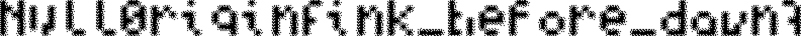

# Slackwater

**Category:** Forensics | **Difficulty:** Easy | **Points:** 250 | **Flag:** `Null0rigin{ink_before_dawn}`

## Challenge Description

> Slack water is the turn of the tide, when the surface tells you nothing.
> This came out of a device someone stopped using in a hurry.

The download is a raw card image, `card.img`. A local verifier and a sealed
confirmation file ship with it, but neither is needed to recover the answer.

> Note: this challenge is part of an internal forensics chain and uses the
> `Null0rigin{...}` (with a zero) chain-internal flag format.

## Initial Analysis

First things first — identify the image and sweep it for readable flag-shaped
strings:

```bash
file card.img
strings -a card.img | grep -oE 'Null0rigin\{[a-z_]+\}' | sort -u
```

`file` calls it a FAT32 volume labelled `NULLCARD`. The strings sweep finds
*fourteen* unique flag-shaped values — things like `Null0rigin{smile_click}`,
`Null0rigin{flash_the_frame}`, `Null0rigin{deleted_isnt_gone}`, and
`Null0rigin{smile_for_the_camera}`. That's the first tell: a three-attempt
verifier plus fourteen tempting answers means the strings are decoys, not the
flag. The "surface tells you nothing," exactly like the flavour text warns.

The volume is deliberately odd enough that some tools refuse to mount it. A
read-only filesystem check still gives us the geometry we need:

```bash
fsck.fat -vn card.img
```

```text
512 bytes per logical sector
4096 bytes per cluster
32 reserved sectors
1 FAT
224 sectors per FAT
Root directory start at cluster 2
Data area starts at byte 131072 (sector 256)
28618 data clusters
```

The `-n` matters: repairing the image would rewrite the FAT, and the FAT *is*
the evidence here.

## The Vulnerability / Core Concept

The data area begins at `0x20000` (cluster 2 = the root directory). Dumping it
shows normal JPEGs, a `README.TXT`, and one deleted entry:

```bash
xxd -s 0x20000 -l 0x1a0 card.img
# 00020160: e54c 4147 2020 2020 5458 5420 ...
```

FAT deletion just overwrites the first filename byte with `0xe5`, so the
original 8.3 name was `FLAG.TXT`. Its entry says it starts at cluster 98 and is
86 bytes. A cluster's byte offset on this image is `0x20000 + (cluster - 2) * 4096`,
so cluster 98 lands at `0x80000`:

```bash
dd if=card.img bs=1 skip=$((0x80000)) count=86 status=none
# "the flag isn't here.
#  (this file is a decoy -- it's recoverable, and that's the point)"
```

So the easy deleted-file recovery is *also* a decoy — and `README.TXT` even
spells out that `Null0rigin{smile_for_the_camera}` came from a thumbnail cache
and is wrong. Every visible path is a trap.

**The real signal is negative space.** Normal metadata and file content run
through cluster 99. From cluster 100 onward *no directory entry points at
anything*, yet 8,441 FAT entries are marked allocated — almost all holding the
end-of-chain value `0x0fffffff`, as if thousands of isolated one-cluster files
existed with no names. The cluster *contents* are just 64 bytes of filler then
zeros; useless. What carries information is the single bit per cluster:
**allocated or free**. Render that bitmap and the flag appears as pixel text.

## Exploitation

Map each cluster from 100 onward to one pixel — nonzero FAT entry = black,
zero = white. There are 28,520 cluster states from cluster 100 to the end:
exactly 36 rows of 792 pixels, plus 8 padding bits. Dump it as a P1 PBM
(`solve_slackwater.py`):

```python
import struct
from pathlib import Path

disk = Path("card.img").read_bytes()
bps      = struct.unpack_from("<H", disk, 11)[0]
reserved = struct.unpack_from("<H", disk, 14)[0]
spf      = struct.unpack_from("<I", disk, 36)[0]
fat = struct.unpack_from(f"<{(spf*bps)//4}I", disk, reserved * bps)

start, width, height = 100, 792, 36
bits = [1 if (fat[c] & 0x0fffffff) else 0
        for c in range(start, start + width * height)]

with open("slackwater_fat_map.pbm", "w") as out:
    out.write(f"P1\n{width} {height}\n")
    for y in range(height):
        out.write(" ".join(map(str, bits[y*width:(y+1)*width])) + "\n")
```

```bash
python3 solve_slackwater.py
```

Open the resulting bitmap and the allocation pattern reads as text:



## Flag

`Null0rigin{ink_before_dawn}`

## Key Takeaways

- When a filesystem challenge buries you in plausible flag strings, that volume
  of decoys is itself a hint: the answer lives in **metadata**, not a file.
- FAT allocation state (the FAT table) can carry a payload independent of the
  cluster contents. One bit per cluster → a bitmap → pixel text.
- Always check a suspicious image **read-only** (`fsck.fat -vn`, no mount). The
  FAT was the evidence; repairing or mounting could have destroyed it.
